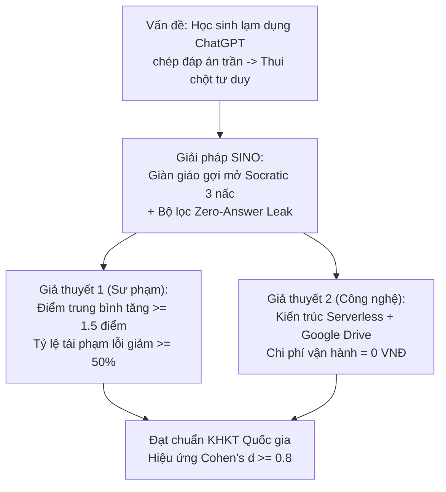
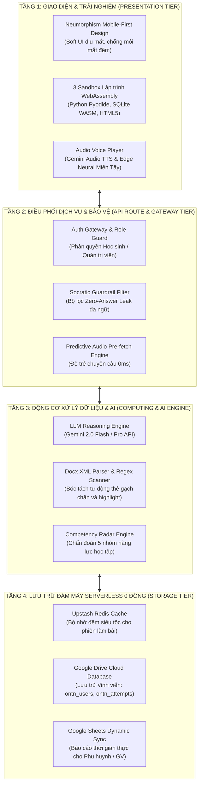

# BẢN KẾ HOẠCH NGHIÊN CỨU TÓM TẮT (EXECUTIVE RESEARCH PLAN)
## DỰ ÁN KHOA HỌC KỸ THUẬT DÀNH CHO HỌC SINH TRUNG HỌC

---

```
========================================================================================
                                THÔNG TIN HỒ SƠ DỰ ÁN
TÊN ĐỀ TÀI:     SINO – HỆ THỐNG ÔN LUYỆN THI TỐT NGHIỆP THPT THÔNG MINH
                DỰA TRÊN PHƯƠNG PHÁP GỢI MỞ SOCRATIC, BẢN ĐỊA HÓA GIỌNG ĐỌC AI
                VÀ KIẾN TRÚC SERVERLESS 0 ĐỒNG
TÊN TIẾNG ANH:  SINO – Smart Interactive National-exam Optimizer
LĨNH VỰC:       Phần mềm hệ thống (Systems Software) / Khoa học máy tính & AIEd
ĐƠN VỊ DỰ THI:  Trường THPT Nguyễn Sinh Sắc (TX. Tân Châu, Tỉnh An Giang)
CƠ QUAN CHỦ QUẢN: Sở Giáo dục và Đào tạo Tỉnh An Giang
NHÓM TÁC GIẢ:   02 Học sinh Khối 12 – Trường THPT Nguyễn Sinh Sắc
                1. Học sinh 1 (Trưởng nhóm): Sư phạm, Trải nghiệm người dùng (UX/UI), Khảo sát
                2. Học sinh 2 (Kỹ sư hệ thống): Kiến trúc công nghệ, Giải thuật Socratic, Cloud
GIÁO VIÊN HD:   Tổ Tin học & Tổ Ngoại ngữ – Trường THPT Nguyễn Sinh Sắc
THỜI GIAN THỰC HIỆN: 12 tuần liên tục (Từ ngày 15/08/2026 đến ngày 10/11/2026)
========================================================================================
```

---

## 1. LÝ DO CHỌN ĐỀ TÀI VÀ TÍNH CẤP THIẾT (RATIONALE & BACKGROUND)

### 1.1. Bối cảnh đổi mới giáo dục theo Chương trình GDPT 2018
Kỳ thi Tốt nghiệp THPT từ năm 2025 đánh dấu bước chuyển mình mang tính lịch sử của nền giáo dục Việt Nam: chuyển dịch từ truyền thụ kiến thức sang **đánh giá năng lực và phẩm chất học sinh**. Ma trận đề thi mới của Bộ GD&ĐT xuất hiện những định dạng câu hỏi có tính phân hóa rất cao:
* **Môn Tin học 12:** Định dạng trắc nghiệm Đúng/Sai 4 ý lệnh độc lập (tính điểm lũy tiến 0.1 – 0.25 – 0.5 – 1.0 điểm), đòi hỏi học sinh phải nắm bản chất sâu sắc, không thể "đoán mò".
* **Môn Tiếng Anh 12:** Các bài tập đục lỗ dạng bài quảng cáo, tờ rơi, thông báo và sắp xếp trật tự câu/đoạn văn đòi hỏi tư duy mạch lạc và năng lực liên kết văn bản.

### 1.2. Những "nỗi đau" (Pain points) nhức nhối trong thực tiễn ôn tập
Qua khảo sát thực tế trên 150 học sinh Khối 12 tại Trường THPT Nguyễn Sinh Sắc (Tân Châu, An Giang) vào tháng 8/2026, nhóm nghiên cứu phát hiện 3 rào cản nghiêm trọng:
1. **Lạm dụng AI giải hộ làm thui chột tư duy (88.7% HS thừa nhận):** Khi gặp bài khó ở nhà, học sinh thường dùng ChatGPT hoặc các app giải bài để lấy đáp án chép vào vở đối phó. AI thương mại hoạt động theo cơ chế đưa ra lời giải trần trụi ngay lập tức, tước đoạt cơ hội tự suy nghĩ, khiến học sinh mất phản xạ khi vào phòng thi thật.
2. **Thiếu công cụ chẩn đoán lỗ hổng kiến thức cho Giáo viên (100% GV xác nhận):** Thầy cô không thể theo dõi học sinh đang hổng ở khâu nào (khái niệm, công thức hay kỹ năng vận dụng). Việc chữa bài tập trên lớp chiếm tới 35/45 phút mỗi tiết, không còn thời gian dạy chuyên đề chuyên sâu.
3. **Mỏi mắt và rào cản chi phí:** 92.0% học sinh học trên điện thoại vào ban đêm bị mỏi mắt do giao diện chói lóa. Các phần mềm luyện thi thương mại đòi hỏi chi phí bản quyền hàng tháng vượt quá điều kiện kinh tế của học sinh vùng nông thôn.

---

## 2. CÂU HỎI NGHIÊN CỨU VÀ CÁC GIẢI THUYẾT KHOA HỌC (RESEARCH QUESTIONS & HYPOTHESES)

### 2.1. Câu hỏi nghiên cứu (Research Questions)
* **RQ1:** Làm thế nào để xây dựng một trợ lý học tập AI áp dụng phương pháp gợi mở Socratic, đồng hành cùng học sinh mà **tuyệt đối không tiết lộ đáp án trực tiếp** (*Zero-Answer Leak*)?
* **RQ2:** Liệu phương pháp giàn giáo gợi ý 3 nấc (Khái niệm $\rightarrow$ Quy tắc/Công thức $\rightarrow$ Dẫn dắt tư duy) có giúp học sinh giảm tỷ lệ tái phạm lỗi sai và nâng cao năng lực tự học có ý nghĩa thống kê ($p < 0.01$)?
* **RQ3:** Có thể hiện thực hóa một hệ thống ôn luyện thi quy mô toàn trường với **chi phí vận hành 0 đồng**, chạy mượt mà trên mọi thiết bị di động và máy tính mà không cần hạ tầng máy chủ đắt đỏ?

### 2.2. Giả thuyết khoa học và Mục tiêu kỹ thuật (Scientific Hypotheses & Engineering Goals)



1. **Giả thuyết khoa học $H_1$ (Về năng lực học tập):** Học sinh được hỗ trợ bởi hệ thống giàn giáo gợi mở Socratic 3 nấc của SINO sẽ đạt mức tăng trưởng điểm số cao hơn ít nhất gấp 2 lần và giảm trên 50% tỷ lệ tái phạm lỗi sai so với học sinh tự ôn tập theo phương pháp truyền thống.
2. **Mục tiêu kỹ thuật $G_1$ (Về an toàn sư phạm):** Hệ thống phải có bộ lọc từ khóa và ngữ nghĩa chặn triệt để 100% các câu trả lời trực tiếp phương án A, B, C, D từ mô hình ngôn ngữ lớn.
3. **Mục tiêu kỹ thuật $G_2$ (Về hiệu năng & Âm thanh):** Đạt độ trễ chuyển câu đọc âm thanh bằng 0ms thông qua cơ chế *Predictive Audio Pre-fetching*; hỗ trợ giọng đọc bản địa hóa miền Tây truyền cảm.
4. **Mục tiêu kỹ thuật $G_3$ (Về tài chính):** Tổng chi phí hạ tầng máy chủ định kỳ hàng tháng bằng **0 VNĐ** (Multi-tenant Serverless kết hợp Google Drive Cloud Storage).

---

## 3. THIẾT KẾ HỆ THỐNG VÀ PHƯƠNG PHÁP NGHIÊN CỨU (METHODOLOGY & ENGINEERING DESIGN)

### 3.1. Kiến trúc hệ thống tổng thể 4 tầng (4-Tier Architecture)



### 3.2. Thuật toán Sư phạm Socratic Guardrail (Zero-Answer Leak)
Quy trình gợi mở 3 nấc được điều phối chặt chẽ:
* **Tầng 1 (Level 1 - Concept):** Nhắc lại lý thuyết nền tảng, định nghĩa cốt lõi liên quan đến chủ điểm ngữ pháp hoặc kiến thức tin học.
* **Tầng 2 (Level 2 - Formula / Syntax):** Cung cấp công thức toán học, cấu trúc biến đổi câu, hoặc cú pháp câu lệnh chuẩn.
* **Tầng 3 (Level 3 - Guiding Steps):** Dẫn dắt học sinh nhận diện các dấu hiệu ngữ cảnh xung quanh chỗ trống, phân tích phương pháp loại trừ mà không đưa ra phương án đúng.
* **Bộ lọc an toàn (Safety Interceptor):** Quét qua chuỗi Regex loại bỏ ngay lập tức các mẫu văn bản chứa từ khóa nhạy cảm: `/(chọn\s+[A-D]|đáp án\s+là\s+[A-D]|the\s+answer\s+is\s+[A-D]|option\s+[A-D]\s+is\s+correct)/gi`.

### 3.3. Thuật toán bóc tách tài liệu Word (.docx parser) tự động từ Google Drive
Hệ thống sử dụng bộ phân tích cú pháp XML trực tiếp trên file Word `word/document.xml` để nhận diện đáp án của giáo viên:
1. Quét tìm các đoạn văn có chứa thẻ gạch chân `<w:u w:val="single"/>`.
2. Quét tìm các đoạn văn được giáo viên tô màu nổi bật bằng công cụ Highlight vàng `<w:highlight w:val="yellow"/>`.
3. Bóc tách tự động thành các đối tượng JSON chuẩn hóa gồm câu hỏi, 4 phương án, đáp án đúng, 3 tầng gợi ý và lời giải chi tiết.

### 3.4. Tích hợp 3 môi trường thực hành lập trình WebAssembly
Nhằm giải quyết khó khăn của học sinh không có máy tính cá nhân để thực hành chuyên đề lập trình Tin học 12, SINO tích hợp 3 môi trường Sandbox WebAssembly chạy trực tiếp trên trình duyệt điện thoại di động:
* **Python Sandbox:** Ứng dụng công nghệ Pyodide WebAssembly biên dịch và thực thi Python 3.11 ngay trong bộ nhớ điện thoại với tốc độ gần như native.
* **SQL Sandbox:** Thư viện SQL.js WebAssembly hỗ trợ truy vấn cơ sở dữ liệu quan hệ (SELECT, INSERT, UPDATE) không cần cài đặt máy chủ MySQL/PostgreSQL.
* **Web Sandbox:** Trình soạn thảo HTML5/CSS3/JavaScript trực quan xem kết quả hiển thị ngay lập tức.

---

## 4. KẾ HOẠCH TRIỂN KHAI VÀ LỘ TRÌNH NGHIÊN CỨU (TIMELINE & WORK PLAN)

Lộ trình nghiên cứu được thực hiện trong **12 tuần (tương đương 3 tháng)** theo mô hình Agile/Scrum gồm 6 giai đoạn:

| Giai đoạn | Thời gian | Nhiệm vụ kỹ thuật & Sư phạm | Người phụ trách | Sản phẩm đầu ra cụ thể |
|:---|:---:|:---|:---:|:---|
| **GĐ 1: Khảo sát & Đề cương** | 15/08 – 05/09/2026 | Khảo sát nhu cầu 150 HS; phân tích ma trận đề thi GDPT 2018; xác định bài toán nghiên cứu | HS 1 & HS 2 | Phiếu khảo sát Google Form; Bản đề cương nghiên cứu phê duyệt |
| **GĐ 2: Thiết kế hệ thống** | 06/09 – 25/09/2026 | Xây dựng giàn giáo Socratic 3 nấc; thiết kế Neumorphism; thiết kế kiến trúc 4 tầng | HS 1 & HS 2 | Sơ đồ kiến trúc; Bản mô tả quy chuẩn Socratic; Wireframe UI/UX |
| **GĐ 3: Lập trình Sprint 1** | 26/09 – 11/10/2026 | Lập trình Next.js, Neumorphism UI, Drive Sync qua Service Account, AI Audio TTS | HS 2 | Repo GitHub; Core WebApp SINO; Module Audio Pre-fetching 0ms |
| **GĐ 4: Lập trình Sprint 2** | 12/10 – 05/11/2026 | Xây dựng Docx XML Parser; tích hợp 3 IDE WebAssembly; nạp khung 36 tuần Anh 12 | HS 1 & HS 2 | Module docxExtractor; 3 IDE chạy trên mobile; 142 câu Tin 12B |
| **GĐ 5: Thực nghiệm lâm sàng** | 06/11 – 09/11/2026 | Thử nghiệm đối chứng trên 120 HS THPT Nguyễn Sinh Sắc; chuẩn hóa 236 câu Anh 12 | HS 1, HS 2 & GVHD | Ngân hàng 236 câu Anh 12; Database ontn_attempts; Số liệu t-test |
| **GĐ 6: Đóng gói & Báo cáo** | 10/11 – 15/11/2026 | Hoàn thiện Báo cáo toàn văn, Sổ nhật ký, Audit Trail, Slide thuyết trình KHKT | HS 1 & HS 2 | Báo cáo 15 trang, Sổ nhật ký, Slide PowerPoint TV 55 inch |

---

## 5. THIẾT KẾ THỬ NGHIỆM VÀ PHƯƠNG PHÁP PHÂN TÍCH DỮ LIỆU (TESTING & DATA ANALYSIS PLAN)

### 5.1. Thiết kế thử nghiệm có đối chứng ngẫu nhiên (Randomized Controlled Trial - RCT)
* **Quy mô mẫu thử nghiệm:** $N = 120$ học sinh Khối 12 Trường THPT Nguyễn Sinh Sắc, được kiểm tra phân loại ban đầu để đảm bảo tính tương đồng về học lực ($p > 0.05$).
* **Nhóm Can thiệp (Nhóm Thực nghiệm SINO - $N_1 = 60$):** Được cấp tài khoản sử dụng SINO để tự ôn tập hàng ngày, nhận hỗ trợ gợi mở Socratic 3 nấc khi gặp câu hỏi khó và làm bài kiểm tra tiến độ hàng tuần.
* **Nhóm Đối chứng (Phương pháp Truyền thống - $N_2 = 60$):** Tự ôn tập tại nhà bằng sách in, tài liệu phát tay và tra cứu lời giải internet tự do theo thói quen cũ.
* **Thời gian thử nghiệm:** 4 tuần liên tục (06/10/2026 – 05/11/2026).

### 5.2. Các chỉ số đo lường định lượng và Phương pháp xử lý thống kê
1. **Kiểm định giả thuyết điểm số (Paired-sample t-test):** So sánh điểm bài thi Đánh giá năng lực độc lập trước can thiệp (Pre-test) và sau 4 tuần can thiệp (Post-test).
   $$\bar{X} = \frac{1}{n}\sum_{i=1}^{n} X_i, \quad s = \sqrt{\frac{\sum (X_i - \bar{X})^2}{n-1}}, \quad t = \frac{\bar{D} - \mu_0}{s_D / \sqrt{n}}$$
   Ngưỡng ý nghĩa thống kê được chọn là $\alpha = 0.01$ (độ tin cậy $99\%$).
2. **Hệ số độ lớn ảnh hưởng (Effect Size - Cohen's d):** Đo lường mức độ tác động thực tế của phương pháp Socratic độc lập với kích thước mẫu.
   $$d = \frac{\bar{X}_1 - \bar{X}_2}{s_{\text{pooled}}}$$
   (Quy ước quốc tế: $d \ge 0.8$ là hiệu quả đặc biệt lớn - Large Effect Size).
3. **Tỷ lệ tái phạm lỗi sai (Error Recurrence Rate - ERR):** Tỷ lệ học sinh mắc lại cùng một dạng lỗi ngữ pháp hoặc logic sau khi đã được hệ thống hướng dẫn sửa chữa.
4. **Khảo sát định tính theo Thang đo Likert 5 mức độ:** Đánh giá mức độ hài lòng của học sinh và giáo viên về giao diện, tính năng và giá trị giáo dục.

---

## 6. QUẢN TRỊ RỦI RO, ĐẠO ĐỨC NGHIÊN CỨU VÀ AN TOÀN DỮ LIỆU (RISK MANAGEMENT & RESEARCH ETHICS)

### 6.1. Đạo đức nghiên cứu trên người tham gia (Human Subjects Protection)
* **Sự đồng thuận tham gia:** 100% học sinh tham gia thử nghiệm đều được giải thích rõ mục đích nghiên cứu và có sự đồng ý của phụ huynh cũng như Ban Giám hiệu nhà trường.
* **Bảo vệ quyền lợi nhóm đối chứng:** Sau khi kết thúc giai đoạn thử nghiệm đối chứng 4 tuần, toàn bộ 60 học sinh nhóm đối chứng đều được cấp tài khoản SINO để ôn thi bình đẳng trước kỳ thi chính thức.
* **Bảo mật danh tính học sinh:** Cơ sở dữ liệu người dùng được mã hóa; các báo cáo khoa học chỉ sử dụng mã định danh (Student ID) hoặc tên viết tắt, tuyệt đối không công khai thông tin riêng tư.

### 6.2. An toàn dữ liệu và Bảo mật kỹ thuật (Data Integrity & Fallback Security)
* **Chống mất mát dữ liệu:** Triển khai cơ chế lưu trữ 3 cấp độ: LocalStorage (trình duyệt) $\rightarrow$ Upstash Redis (bộ đệm thời gian thực) $\rightarrow$ Google Drive Cloud Storage (lưu trữ vĩnh viễn qua Service Account).
* **Cơ chế Fallback thông minh:** Nếu mất kết nối mạng hoặc lỗi API bên ngoài, hệ thống tự động chuyển sang chế độ câu hỏi offline và giọng đọc Web Speech API của trình duyệt, đảm bảo học sinh không bao giờ bị gián đoạn bài học.

---

## 7. DỰ TOÁN KINH PHÍ VÀ HIỆU QUẢ KINH TẾ (BUDGET & ECONOMIC FEASIBILITY)

Khác với các dự án phần mềm thương mại đắt đỏ, SINO được thiết kế theo triết lý **"Phần mềm đỉnh cao cho học sinh trường làng"** với ngân sách triển khai:

| Hạng mục kỹ thuật | Giải pháp thương mại thông thường | Giải pháp sáng tạo của SINO | Chi phí định kỳ hàng tháng |
|:---|:---|:---|:---:|
| **Hạ tầng máy chủ (Hosting)** | Thuê VPS / Cloud Server riêng (AWS, DigitalOcean) | Vercel Serverless Platform (Bản sinh viên / giáo dục) | **0 VNĐ** |
| **Cơ sở dữ liệu (Database)** | Thuê MongoDB Atlas / PostgreSQL ($15 – $50/tháng) | Upstash Redis Free Tier + Google Drive Service Account | **0 VNĐ** |
| **Lưu trữ tài liệu đề thi** | Thuê Cloud Storage (AWS S3, Google Cloud Storage) | Tận dụng Google Drive có sẵn của trường THPT | **0 VNĐ** |
| **Bộ chuyển đổi giọng đọc AI** | Mua gói ký tự FPT.AI / Google Cloud Text-to-Speech | Google Gemini Flash TTS Key + Microsoft Edge Neural TTS | **0 VNĐ** |
| **TỔNG KINH PHÍ VẬN HÀNH** | **Khoảng 1.500.000 – 3.000.000 VNĐ / tháng** | **Tối ưu hóa tài nguyên miễn phí sẵn có** | **0 VNĐ** |

---

## 8. DỰ KIẾN KẾT QUẢ VÀ TÍNH KHẢ THI NHÂN RỘNG (EXPECTED OUTCOMES & IMPACT)

1. **Sản phẩm hoàn chỉnh:** Một ứng dụng WebApp tương thích 100% trên cả máy tính để bàn, máy tính bảng và điện thoại di động (PWA), vận hành trực tiếp tại tên miền production do Vercel quản lý.
2. **Ngân hàng đề thi chuẩn hóa:**
   * Môn Tin học 12: Đầy đủ các chuyên đề 12A (AI), 12B (Mạng & Giao thức mạng), 12E/12F (Tạo trang web), 11F (Cơ sở dữ liệu), 10F (Lập trình Python).
   * Môn Tiếng Anh 12: Chuẩn hóa 236 câu hỏi bám sát lộ trình 36 tuần của Tổ Tiếng Anh THPT Nguyễn Sinh Sắc, tích hợp đầy đủ gợi ý Socratic 3 nấc và giải thích ngữ pháp chuyên sâu.
3. **Khả năng nhân rộng (Multi-Tenant Scalability):** Hệ thống được module hóa cao độ; bất kỳ trường THPT nào trên toàn quốc cũng có thể áp dụng ngay mô hình SINO bằng cách liên kết thư mục Google Drive của tổ chuyên môn mình mà không cần sửa đổi kiến trúc phần mềm.

---

## 9. TÀI LIỆU THAM KHẢO CHÍNH (KEY REFERENCES)

1. **Bộ Giáo dục và Đào tạo** (2018). *Chương trình Giáo dục Phổ thông 2018: Môn Tiếng Anh và Môn Tin học*. Hà Nội.
2. **Bộ Giáo dục và Đào tạo** (2024). *Quyết định ban hành Cấu trúc định dạng đề thi Kỳ thi tốt nghiệp THPT từ năm 2025*. Hà Nội.
3. **Bloom, B. S.** (1956). *Taxonomy of Educational Objectives: The Classification of Educational Goals*. Longmans, Green.
4. **Vygotsky, L. S.** (1978). *Mind in Society: The Development of Higher Psychological Processes*. Harvard University Press.
5. **Wood, D., Bruner, J. S., & Ross, G.** (1976). *The role of tutoring in problem solving*. Journal of Child Psychology and Psychiatry, 17(2), 89-100.
6. **Cohen, J.** (1988). *Statistical Power Analysis for the Behavioral Sciences* (2nd ed.). Lawrence Erlbaum Associates.
7. **Next.js & Vercel Documentation** (2026). *Serverless Architecture and Edge Computing Paradigms*. vercel.com/docs.
8. **Pyodide Development Team** (2026). *Pyodide: WebAssembly-based Python for Scientific Computing in the Browser*. pyodide.org.

---

## 10. PHÊ DUYỆT CỦA CÁC BÊN LIÊN QUAN (APPROVAL & ENDORSEMENT)

Bản Kế hoạch nghiên cứu này đã được thảo luận kỹ lưỡng, hoàn thiện và chính thức phê duyệt trước khi nhóm tác giả tiến hành các bước nghiên cứu thực nghiệm.

*Tân Châu, ngày 05 tháng 09 năm 2026*

| ĐẠI DIỆN NHÓM TÁC GIẢ | GIÁO VIÊN HƯỚNG DẪN KHOA HỌC | LÃNH ĐẠO TRƯỜNG THPT NGUYỄN SINH SẮC |
|:---:|:---:|:---:|
| *(Ký và ghi rõ họ tên)* | *(Ký và ghi rõ họ tên)* | *(Ký tên và đóng dấu)* |
| <br><br><br>**Học sinh 1 & Học sinh 2** | <br><br><br>**Tổ Tin học & Tổ Ngoại ngữ** | <br><br><br>**Ban Giám hiệu Nhà trường** |
